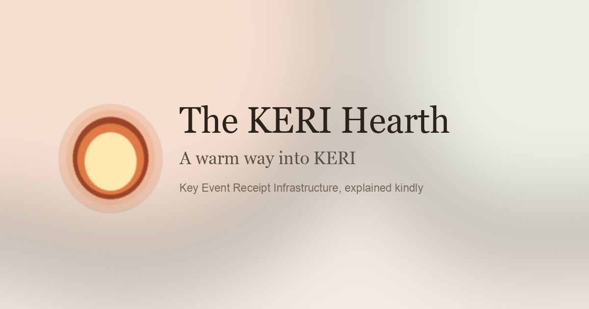

# Understanding KERI

A plain-language way into [KERI](https://keri.foundation) (Key Event Receipt Infrastructure), pronounced like the name Carrie.

**Live site:** [The KERI Hearth](https://kordwarshuis.github.io/understanding-KERI/)



KERI is hard to adopt because it is hard to explain. This repo keeps an English reading library and a small web app that retells those ideas for different people.

## The KERI Hearth

The app lives at the repository root. You sit down as a parent, a lawyer, a policymaker, a developer, a business leader, or a clinician. Each path is a short sequence: why it matters, what KERI is, how it works, and what to do next.

There is also an animated explainer of what KERI does (`/what`, nine short scenes about outcomes rather than mechanics), a shared story (“A name that can change its locks”), a glossary, and a sources page. Lesson progress is stored in the browser. The explainer shows still frames when the system asks for reduced motion.

The writing is a reading of the English texts in `txt/`. The app itself is available in English and Dutch (EN / NL in the header, or `?lang=en` / `?lang=nl` in the URL). It is not the specification, not legal advice, and it does not issue identifiers or hold keys.

### Run it

Requires Node.js and npm.

```bash
npm install
npm run dev
```

Then open the URL Vite prints (usually http://127.0.0.1:5173/).

```bash
npm run build
npm run preview
```

`npm run build` writes a static site to `dist/`.

### Seats

| Person | Role | Question they bring |
| --- | --- | --- |
| Maya | Concerned parent | Who holds the keys to a family’s name? |
| Elena | Legal professional | What would hold up as proof? |
| Jonas | Policymaker | How do we get security without a surveillance file? |
| Priya | Developer | What are the objects and trust boundaries? |
| Omar | Business leader | Can this cut fraud without locking us to a vendor? |
| Aisha | Healthcare professional | Can records move without pooling the whole chart? |

## Source texts

`txt/` holds the English material the app is drawn from: the Hitchhiker’s Guide, the jargon series, foundation and conference notes, and related essays. Translations were left out on purpose.

The app does not load those files at runtime. Edited explanations live in `src/content/`.

## Layout

```
txt/                 English source texts
src/                 Vue 3 + Vue Router app
  content/           English personas, glossary, story, explainer, sources
  content/nl/        Dutch translations of that content
  i18n/              Locale switch and UI chrome strings
  components/scene/  SVG figures used by the explainer
  views/             Pages
index.html
vite.config.js
```
